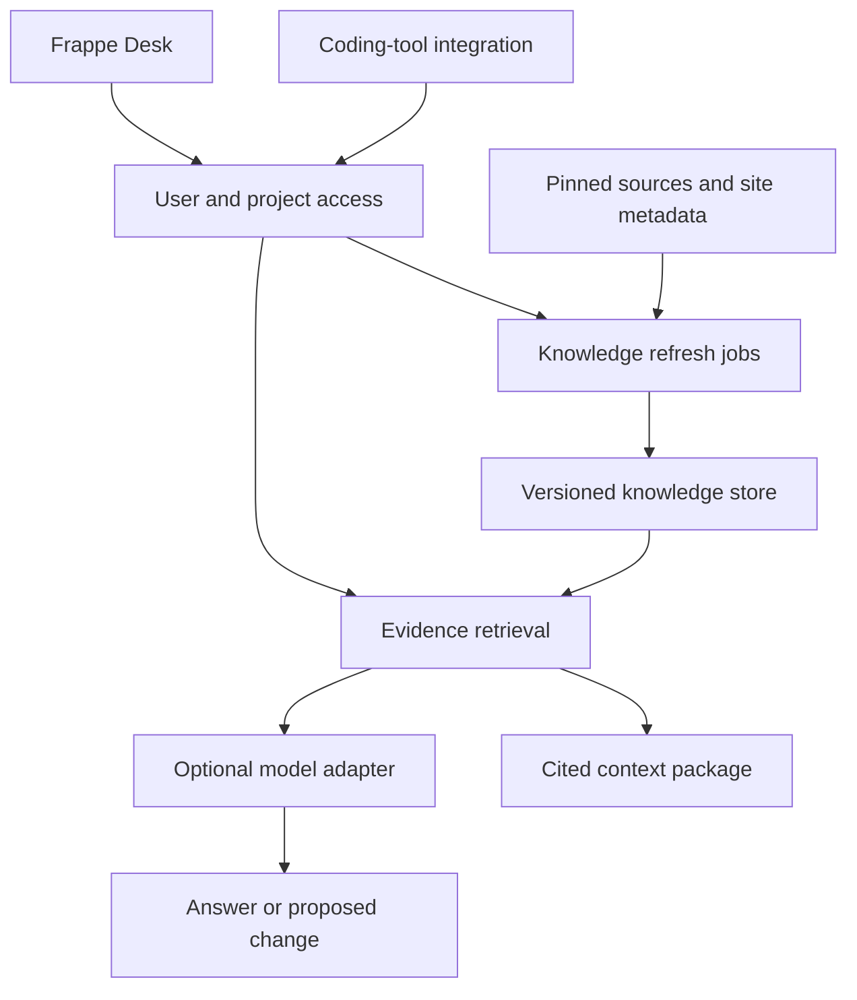
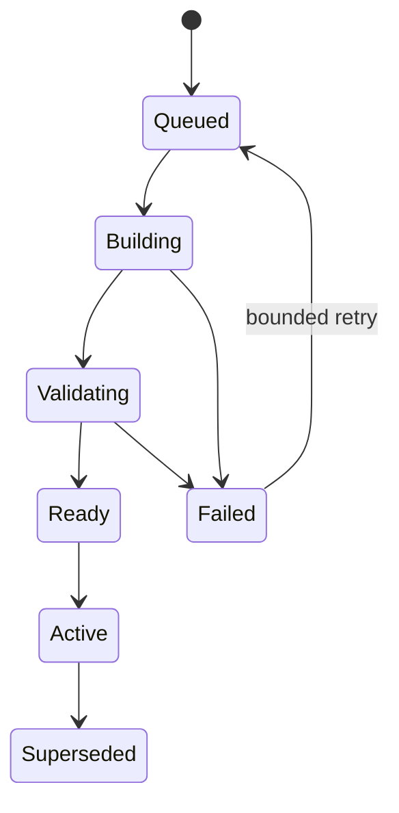

# Frappe Knowledge — v16 architecture

Prepared for Muneeb Mohammed • 18 October 2026 • Decision baseline 0.1

## Decision and product boundary

Build an installable Frappe knowledge kit that supplies versioned, installation-aware evidence and cross-app impact context to AI-assisted support and development. An AI client should be able to read its authorized local context without web research; support staff should eventually use a cited question-and-answer UI. The first release supports **Frappe, ERPNext and HRMS v16 only**. Its first workflow is payroll and its accounting connections. General business automation and autonomous production code changes are later products, not assumptions in this foundation. See [product direction](PRODUCT_DIRECTION.md).

The differentiator to validate is whether the product catches consequential cross-app or version mistakes that a competent coding assistant with repository search and existing Frappe skills misses. A dashboard with many agents is not evidence of value. Model savings are a hypothesis until measured on correctly completed tasks.

No architecture can guarantee that requirements, providers or upstream frameworks will never change. This design limits the cost of change by isolating source ingestion, domain knowledge, retrieval, model orchestration and execution. Add boundaries now; distribute services only when measured needs justify it.

## Deployment shape

Start as a **modular Frappe app**, using the site's existing database and background-worker facilities. Keep deterministic extraction and context construction in a Python core that imports neither Frappe nor an LLM SDK. Keep site integration in adapters. A portable CLI exercises the core without a bench.

The coding-tool and model paths are planned integration points. The current prototype implements extraction, an indexed snapshot adapter, bounded context retrieval, a diff plan, and the Frappe adapter scaffold. It does not yet implement this entire diagram.

Do not make Flow, FAC, a model vendor, Neo4j or a vector database a mandatory dependency of the domain. Current Frappe Flow can be evaluated for v16 orchestration; FAC can be evaluated for MCP/tool integration. They must consume the same knowledge/context contract. The product must remain useful if either is removed or changes API.

## Boundaries and ownership

| Boundary | Owns | Must not own |
|---|---|---|
| Frappe adapter | User authentication, project authorization, DocTypes, jobs, Desk UI | Core extraction logic or vendor-specific reasoning |
| Source adapters | Approved repositories, immutable revisions, documentation capture, site metadata export | Executing repository code or trusting source instructions |
| Deterministic core | Source identities, evidence, static relations, snapshot comparison | Network credentials, tenant database access or model state |
| Knowledge repository | Immutable snapshots, evidence artifacts, active-snapshot publication | Silent rewriting of old answers or source history |
| Retrieval service | Version/scope filtering, lexical search, bounded graph expansion, optional semantic ranking | Answering from unsupported assumptions |
| Model adapter | Provider invocation, supported capabilities, usage accounting | Access authorization or changing source truth |
| Learning service | Candidate lessons, verification evidence, promotion and retirement | Treating every failure as a global rule |
| Development runner | Isolated code changes and checks in a selected repository | Direct execution against customer production sites |

Proposed contracts are `SnapshotStore`, `SourceAdapter`, `SiteProfileReader`, `Retriever`, `ModelAdapter`, `UsageLedger`, `LessonStore` and `ExecutionRunner`. Version their serialized inputs and outputs independently from framework and model releases. These are architectural contracts to implement as milestones, not a claim that all adapters exist today.

## Source of truth and installation identity

An installation profile must record the separate app revisions for Frappe, ERPNext, HRMS and every relevant custom app. A major version or branch name alone is insufficient. Capture the site configuration facts that affect the requested behavior, effective metadata, relevant workflows and overrides, and a revision of this profile.

Prefer immutable deployment manifests or a verified clean checkout. A Frappe Cloud site may not expose Git or an editable filesystem; do not assume it does. An authorized development worker can index pinned upstream sources while the site exports its effective metadata and deployment identity. Mark identity as verified, declared or unavailable. If it is unavailable, show the limitation and avoid claiming exact installation behavior.

Source evidence includes app, repository, full commit SHA, repository-relative path, content hash and line range. Documentation additionally needs URL, captured time, hash and explicit version applicability where known. A documentation capture timestamp is not proof that its contents describe the installed version.

Never upgrade a customer's applications when they click **Refresh knowledge**. A newer upstream revision is another snapshot; it becomes the selected source only when appropriate for the installation or an explicit upgrade investigation.

## Knowledge model

| Entity | Key fields and purpose |
|---|---|
| Project | Site/tenant binding, source policy, allowed users, target major=16, retention and budgets |
| Source revision | App/repository/commit, version, source type, provenance status and license reference |
| Installation profile | Installed app set, effective customization/configuration revision and verification status |
| Evidence artifact | Source revision, path, content hash, captured text/chunks, line ranges, access scope |
| Knowledge node | Stable logical identity, kind, title, source evidence and snapshot membership |
| Dependency edge | Endpoints, relation type, evidence, extraction method, conditions and verification status |
| Workflow record | Business trigger, lifecycle, settings, expected outcomes and validated integration tests |
| Snapshot | Complete selected source set, extractor/schema versions, artifact manifest and coverage report |
| Lesson | Candidate/Validated/Retired status, cause, remedy, evidence, applicable revisions and scope |
| Run/usage entry | Actor, snapshot, retrieval decisions, model usage, latency, outcome and actual cost |

Phase 2 stores new snapshots in batched `FK Knowledge Row` records: file hashes, node/evidence payloads, edge/evidence payloads and title-search terms. Snapshot metadata stays separate. A rebuildable `FK Source Chunk` table stores bounded text from hash-verified local checkouts, with an InnoDB FULLTEXT search projection. Indexed retrieval selects exact/title and source-text matches, expands bounded edge neighborhoods and builds the same context contract without loading the complete graph. A migration copied the historical sample to indexed rows, verified the reconstructed snapshot hash and retained its original JSON as a rollback copy. The full local three-app corpus has been stored and queried; this remains a prototype with a 20 MB HTTP import limit, incomplete semantic coverage and no production-scale concurrency/p95 evidence.

Nodes are facts or source locations, not permanent model instances. Skills describe procedures; knowledge records describe observed implementation. The prototype contains selected unchanged upstream skill reference documents, not a complete or auto-installed skill library.

## Extraction coverage and uncertainty

P0, implemented: DocType Link/Table relationships, Python imports, standard controller-file conventions and literal DocType arguments in selected Frappe calls. Placeholder references remain visibly unresolved when their definitions were not indexed. Python and JSON are parsed as data; imported application code is never run.

P1/P2, to implement: hooks and resolution order, effective Custom Fields/Property Setters, workflow transitions, document lifecycle, whitelisted endpoints, client-side calls, background jobs, relevant reports, patches and app requirements. Exact source evidence must accompany each extracted relationship.

Static Link relationships do not establish a business workflow, permissions, side effects or cancellation behavior. Dynamic Link targets, computed dispatch, configuration-dependent behavior and runtime-generated code need additional resolution or tests. Use statuses such as `extracted`, `inferred`, `runtime-observed` and `test-verified`; do not turn a numerical model confidence into proof.

The current extractor is intentionally incomplete. A full repository can still have **partial semantic coverage**. Report file coverage, extractor coverage, parse failures, size exclusions, unresolved targets and unimplemented relationship families separately.

## Retrieval and answer contract

1. Authenticate and authorize the caller for the project and knowledge capability.
2. Select an exact snapshot and installation profile. Enforce scope before searching or reading cached context.
3. Identify seed nodes with lexical identifiers/aliases first. Add vector retrieval only if evaluation shows a material recall gap.
4. Expand relevant dependency edges within depth, node, character/token and time budgets. Include why each neighbor was selected.
5. Construct a context package containing evidence links, applicability, unresolved references, coverage limitations and truncation flags.
6. Either return that package to an existing coding assistant or invoke an explicitly configured model.
7. Return an answer or change plan with supporting evidence, assumptions, unknowns, affected workflows and proposed checks.

One model is the default. Role overrides and extra agents are optional. An agent should be added for a demonstrably independent task, a different tool/access boundary or an evaluation benefit—not because a new feature was added to the repository.

The prototype enforces character budgets, not true provider token counts. The model adapter must later account for the full request, tool schemas, conversation history, output/reasoning tokens, retries and provider-specific caching. Character limits must never be advertised as token guarantees.

## Refresh and publication

A refresh identity consists of project, selected source revisions, installation-profile revision, extractor version and policy version. Use it for idempotency. Resolve mutable source references once, then operate on immutable revisions.

Compare file/content hashes, re-extract changed files, remove deleted-node memberships, follow reverse dependencies conservatively, and mark associated summaries/lessons for revalidation. Changing an extractor can require a full reindex. Reuse unchanged content artifacts by hash without confusing snapshot identity with content identity.

Build and validate off to the side. Publish the active-snapshot pointer atomically only after integrity, coverage and required evaluation checks pass. The previous active snapshot remains available while refresh fails or is queued. Old answers retain their original source identities. The prototype currently provides the diff/invalidation **plan**; background incremental processing and atomic activation remain planned.

## Automatic experience capture

Capture task failures and successful remedies into a candidate record, after removing secrets and unnecessary customer data. Record the original request, actual symptom, confirmed cause, changed artifacts, checks, app revisions and scope. Deduplicate related incidents before generating a new procedure.

Promote a lesson only with an explicit verification policy: a reproduced issue, a validated remedy, applicable source scope and sufficient checks/review. Automatic promotion can later be enabled for narrow, low-impact cases that meet those checks. Keep an audit trail, a rollback path and a retired state. Reassess a validated lesson when its supporting source changes.

This updates external knowledge and procedures; it does not train the model's weights. Private customer lessons never become shared upstream guidance by default. Do not copy complete conversations or HR records into a global knowledge store.

## Authorization and isolation

P0 exposes knowledge APIs and the Desk page only to System Manager and checks both project and snapshot permissions. This is a restricted prototype, not the final support-team permission model.

Before broader access, implement an explicit project-member/knowledge-role model, and authorize retrieval, exports, traces, lessons and cached results consistently. Cache keys must include project/tenant, snapshot, installation profile, authorization scope and retrieval policy. Role changes must invalidate or re-evaluate cached access.

An index worker receives only approved sources. Do not index arbitrary server paths from an HTTP parameter. Keep source retrieval separate from write/execution tools, treat repository/skill content as untrusted data, validate external source destinations, and prevent retrieved text from expanding tool permissions. Keep credentials out of snapshots, context packages and logs.

## Environment strategy

- **ChatGPT Project:** discussion, architecture, decisions and progress context; not the source-of-truth code repository.
- **Git repository:** source, migrations, tests, provenance, architecture and decisions.
- **Codex Cloud or a local development environment:** implementation and isolated validation. It is not customer application hosting.
- **Frappe Cloud staging:** install the app from the Git repository on an appropriate v16 bench, test migrations and jobs, then evaluate a pilot.

Pinned v16 Frappe metadata checked in this research declares Python `>=3.14,<3.15` and Node `>=24`. The local Bench has compatible Python, Node, MariaDB and Redis; the schema, restricted APIs and JSON Desk viewer have been exercised on `ai.localhost`. Fresh install and uninstall/reinstall passed on an isolated local MariaDB site; broader integration checks remain. The fetched official Docker development guide contains older-version examples; do not reuse its defaults without reconciling them with the pinned v16 manifests.

## Future changes without a wholesale redesign

| Future requirement | Extension point | Trigger for adding it |
|---|---|---|
| Another model/provider | Model adapter and capability/usage mapping | User choice plus measured quality/cost |
| Semantic retrieval | Retriever/ranker port | Lexical retrieval misses benchmark evidence |
| External graph/search service | Knowledge repository and graph query adapter | Measured database/query scale problems |
| Dedicated indexing workers | Source/job interfaces | Measured CPU, memory, queue or tenant-isolation need |
| Additional apps | Source extractor and workflow packs | A concrete supported app/workflow |
| Another major version | Separate compatibility profile and evaluation suite | Explicitly expanding beyond the v16 release |
| Autonomous code proposals | Isolated execution runner and review workflow | Read-only product has proven value |

Do not promise zero architectural changes. Promise documented boundaries, versioned contracts, migration plans and evidence for each expansion.

## Acceptance before calling this a product

A clean v16 install must pass migrations and role tests. The assistant must answer with traceable source context and acknowledge insufficient evidence. A representative held-out task set must show useful cross-app recall and fewer consequential mistakes than the baseline. Total cost per correctly completed task, latency and refresh cost must be measured. A pilot must demonstrate that another Frappe team can use the app without the author explaining every result.

The exact implementation state is in `STATUS.md`; proposed components in this document must not be reported as delivered merely because they are designed.
